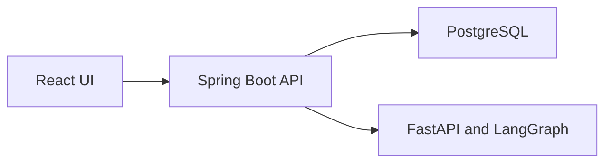

# AI Incident Investigation Platform

An engineer submits a failed batch job or workflow. The platform collects evidence from several synthetic systems, builds a timeline, and writes a report that cites that evidence and says what is still uncertain.

Phase 0 is the bootstrap. The three processes start and report that this is a synthetic test environment. Incident storage, connectors, the deterministic investigation, the model workflow, and the report screens come in later phases. The execution plan is [`docs/implementation-plan.md`](docs/implementation-plan.md).

## What it does not do

- It does not watch production or open an incident by itself.
- It does not start, stop, or repair jobs, and it does not change case state.
- It does not call a live AutoSys, OpenShift, or release-management system. Those adapters stay simulated until a real read-only API is verified.
- A local run is not a production-readiness claim.

## Why the data is synthetic

The project is independent. Fixtures stand in for scheduler history, application logs, Git history, release records, and runbooks. A synthetic adapter must say it is synthetic. It must not be described as a vendor integration.

## Components



| Process | Role in Phase 0 |
|---|---|
| Spring Boot API | `GET /api/platform/status` and `/actuator/health` |
| FastAPI service | `GET /health`. It does not call a model yet |
| React UI | A page that says this is a synthetic test environment |
| PostgreSQL 18 | Chosen and documented. Not started in Phase 0 |

Decisions are in [`docs/adr/`](docs/adr/). Versions are in [`docs/toolchain.md`](docs/toolchain.md). Commands and conventions are in [`docs/development-standards.md`](docs/development-standards.md). A bottom-up reading of Python and the AI service is in [`docs/python-and-the-ai-service.md`](docs/python-and-the-ai-service.md). The same kind of reading for Java and the backend is in [`docs/java-and-the-backend.md`](docs/java-and-the-backend.md).

## Local setup

Requirements: Java 21, Maven 3.9 or the backend wrapper, Python 3.13, [uv](https://docs.astral.sh/uv/), Node.js 24, and npm. Docker is required from the phase that starts PostgreSQL.

```bash
cp .env.example .env
```

`.env` stays untracked. Fill in `OPENAI_API_KEY` only when a later phase runs a live model. Tests do not read that key.

If you use [direnv](https://direnv.net/), allow the repository once:

```bash
direnv allow
```

Phase 0 listens on localhost only.

```bash
cd backend && ./mvnw spring-boot:run
cd ai-service && uv run uvicorn app.main:app --host 127.0.0.1 --port 8000
cd frontend && npm install && npm run dev
```

The API status payload is `http://127.0.0.1:8080/api/platform/status`. The API document is `http://127.0.0.1:8080/swagger-ui.html`. The AI health payload is `http://127.0.0.1:8000/health`. The UI is `http://127.0.0.1:5173/`.

## Tests

```bash
cd backend && ./mvnw -B verify
cd ai-service && uv sync && uv run ruff check . && uv run ruff format --check . && uv run mypy app tests && uv run pytest
cd frontend && npm install && npm run lint && npm run format:check && npm test && npm run build
```

## Configuration

`.env.example` lists the settings. The selected model provider is OpenAI, model `gpt-6-luna`, reasoning effort `none`. `LLM_PROVIDER` can point at another OpenAI-compatible endpoint later. The key never goes in the browser.

## License

No license is chosen yet.
