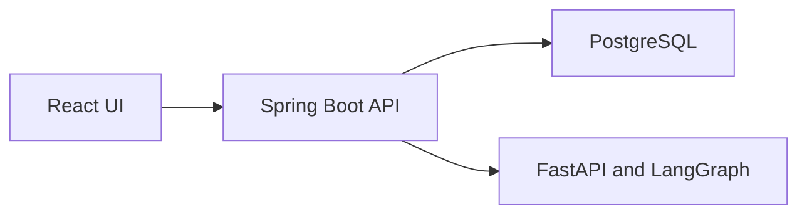

# Architecture

Phase 0 establishes the process boundaries. Incident storage, connectors, and the investigation workflow are later phases. The decisions are in `docs/adr/`. The versions are in `docs/toolchain.md`.

The Spring Boot process owns incident state, evidence, and audit history. It calls the Python service with a bounded evidence bundle. The Python service does not connect to source systems and does not write the system of record. PostgreSQL is reached only by the backend.

Phase 0 runs the API, the AI process, and the UI as separate health endpoints. The database is not connected yet. Every screen and health payload says the environment is synthetic.
